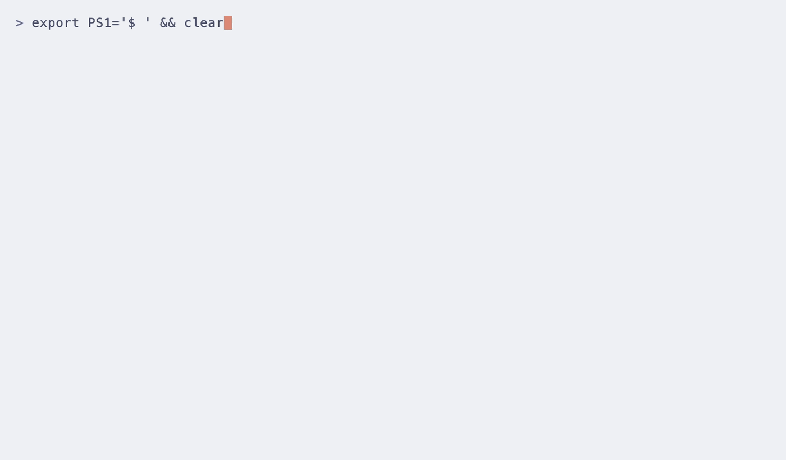

# sapu

A Mac cleaner for the command line that never deletes anything you can't undo,
and explains where your disk went. *Sapu* is Indonesian for "broom".

Run `sapu clean`, read the list it shows, and answer `n` if you are not sure.
Nothing moves until you say yes. The downloads are not signed with an Apple
Developer ID or notarized yet; see [docs/verify.md](docs/verify.md).



## Quick start

**Homebrew**

```sh
brew install khmuhtadin/sapu/sapu
```

**One-line install.** Checks the download's SHA-256, puts `sapu` in
`~/.local/bin`, never uses sudo. [Read the script](install.sh) first if you
like.

```sh
curl -fsSL https://sapu.khaisa.studio/install.sh | sh
```

**Run it once with npx.** Needs Node.js; installs nothing permanently.

```sh
npx @khmuhtadin/sapu
```

**With an AI agent.** Paste this into Claude Code, Codex, Cursor or another
coding agent:

```text
Install Sapu (https://github.com/khmuhtadin/sapu) with
`brew install khmuhtadin/sapu/sapu`, add it to yourself as an MCP server
(`sapu mcp`), then tell me where my disk space went and prepare a safe
cleanup plan. Do not apply the plan: show me the `sapu apply` command so I can
review and run it myself.
```

The MCP server is read-only: an agent can look and prepare a plan, never move
or delete anything. Setup for each agent: [docs/mcp.md](docs/mcp.md).

**As a Claude Code plugin.** Adds the MCP server and a skill that teaches the
agent to clean safely:

```text
/plugin marketplace add khmuhtadin/sapu
/plugin install sapu@sapu
```

**Then:**

```sh
sapu              # the menu: summary, cleanup, quarantine, history
sapu clean        # review what can go; nothing moves until you say yes
sapu undo --last  # put the last cleanup back
```

## What it does

Sapu finds caches, logs and build leftovers that are safe to remove, shows you
what each one is, and moves the ones you pick into a quarantine folder. It also
explains the "System Data" number in macOS storage settings, part by part.

Three promises:

1. **Quarantine and undo.** Nothing is deleted when you clean. Items move to a
   quarantine folder and `sapu undo` puts them back exactly as they were.
   Quarantined items are deleted for good after 7 days (the default; see `max_age` in `sapu.toml`), sooner if the
   quarantine grows past 20 GB (oldest runs first), or when you say so.
2. **Explanations.** Every item says what it is, whether it comes back by
   itself, and how risky it is (safe, moderate, risky). Risky items are never
   selected by default.
3. **Protection.** Caches that are really data (IDE settings, AI models, agent
   memory, Mail, Notes, virtual machines, passwords) are on a built-in list and
   can't be cleaned, whatever a rule says. Files that are open right now are
   skipped.

How it works in detail: [docs/safety.md](docs/safety.md).

## Install and verify

Sapu needs macOS 13 or later. Releases are checked with SHA-256 checksums and
a cosign signature, and are **not** signed with an Apple Developer ID or
notarized yet. [docs/verify.md](docs/verify.md)
explains what that means.

**From GitHub Releases.** Download the archive for your Mac (one universal
binary for Apple Silicon and Intel), verify it, and put `sapu` on your `PATH`:

```sh
VERSION=0.2.0
BASE=https://github.com/khmuhtadin/sapu/releases/download/v$VERSION
cd "$(mktemp -d)"
curl -fsSLO $BASE/sapu_${VERSION}_darwin_universal.tar.gz
curl -fsSLO $BASE/checksums.txt
curl -fsSLO $BASE/checksums.txt.sigstore.json

shasum -a 256 -c checksums.txt --ignore-missing
cosign verify-blob \
  --bundle checksums.txt.sigstore.json \
  --certificate-identity-regexp '^https://github.com/khmuhtadin/sapu/\.github/workflows/release\.yml@refs/tags/v' \
  --certificate-oidc-issuer https://token.actions.githubusercontent.com \
  checksums.txt

tar -xzf sapu_${VERSION}_darwin_universal.tar.gz
mkdir -p ~/.local/bin
install -m 755 sapu ~/.local/bin/sapu
```

`shasum` must print `OK` and `cosign` must print `Verified OK`; if either
fails, do not run the file. cosign is `brew install cosign`. Make sure
`~/.local/bin` is on your `PATH` (add `export PATH="$HOME/.local/bin:$PATH"` to
`~/.zshrc`), then run `sapu version`. If you downloaded the archive with a
browser and macOS refuses to open `sapu`, remove the download flag after
verifying: `xattr -d com.apple.quarantine sapu`. More in
[docs/verify.md](docs/verify.md).

**With Go 1.25 or later:**

```sh
go install github.com/khmuhtadin/sapu/cmd/sapu@v0.2.0
```

This builds Sapu on your Mac and puts it in `$(go env GOPATH)/bin`. It skips
the checks above, and `sapu version` prints `dev` because the version number is
set only in release builds. Go verifies the module against the public Go
checksum database.

**From a checkout:** `make build` writes `bin/sapu`.

**Homebrew** uses the tap
[khmuhtadin/homebrew-sapu](https://github.com/khmuhtadin/homebrew-sapu), which
installs the same release archive and checks its SHA-256.

**Official sources.** The Sapu command-line tool comes only from the
[Releases page](https://github.com/khmuhtadin/sapu/releases) of
[github.com/khmuhtadin/sapu](https://github.com/khmuhtadin/sapu), and from
three channels that install those same files: the Homebrew tap
`khmuhtadin/sapu`, the npm package [`@khmuhtadin/sapu`](https://www.npmjs.com/package/@khmuhtadin/sapu),
and the installer at `https://sapu.khaisa.studio/install.sh`. The website is
[sapu.khaisa.studio](https://sapu.khaisa.studio). Other sites, ads and files
sent to you in chat that offer "Sapu" are not ours.

## Using sapu

```sh
sapu                       # the menu on a terminal; a summary in a script or pipe
sapu clean --plan p.json   # save the plan to p.json; changes nothing
sapu clean                 # review, confirm, then move items to quarantine
sapu undo --last           # changed your mind? put everything back
```

The summary of `sapu` and `--plan` only read. `--plan` writes the plan file and says where; it
replaces `p.json` if that is already a plain file. When `sapu clean` finishes
it tells you when the space will actually be freed: moved files still use disk
space until the quarantine expires (7 days, sooner if it passes 20 GB, by default) or you
run `sapu quarantine empty`.

### The menu

On a terminal, plain `sapu` opens a menu: the mascot on the left, seven numbered
choices on the right. Move with `↑` `↓`, open with `enter` or a number, `?`
lists the keys, `q` quits.

| Choice | What it opens |
|---|---|
| 1 Scan & review | The review screen below, the same as interactive `sapu clean` |
| 2 Explore storage | The folder explorer (`sapu analyze`), or the System Data explanation (`sapu explain`) |
| 3 Tools | A list of tools to pick from: uninstall an app, build folders, large old files, duplicate files, similar photos, old installers, empty folders and broken links, empty the Trash, iPhone and iPad backups, login items |
| 4 Quarantine | The runs Sapu holds, when each can expire, a restore, and delete for good |
| 5 History | Your past runs (`sapu history`) |
| 6 System check | The checks of `sapu doctor` |
| 7 Settings | The whitelist and the settings in effect, with the commands that change them |

On the Tools screen, move with `↑` `↓` and open a tool with `enter` or its
number (`1` to `9`, `0` for the tenth). A tool that looks in folders first says
where ("Looks in: ~/Developer, ~/Projects"): `enter` looks there, `f` lets you
type one folder instead (`~` is your home folder; Sapu says so if it is not a
folder). Uninstall lists your installed apps, without Apple's; type to filter
and press `enter` on one. The other tools look at once. Each tool then opens the
review screen below, with the tool's name in its header, and you come back to
the menu after it. `esc` goes back from any of these screens and runs nothing.

No choice moves or deletes anything by itself. The review screen and the folder
explorer ask on their own confirmation screens. The only changes the menu can
make are on the Quarantine screen. `enter` asks to restore the run under the
cursor, the same way `sapu undo RUN_ID` does. `d` asks to delete that run for
good, and `D` to delete every run, the same way `sapu quarantine empty` does,
to free the space now. Only `y` on the question does it; there is no undo after
a delete. Leaving a screen returns to the menu.

The menu opens only when stdin and stdout are terminals, `--json` is not set and
`SAPU_NO_TUI` is unset. Otherwise `sapu` prints a summary and the next steps.
At 60 columns or fewer the summary stacks its rows. `sapu --json` is unchanged.

The mascot and its lime `=` patch (`#BDEE63`) appear only in the menu and in the
help of an interactive terminal (`sapu --help`). With `NO_COLOR`, or when the
output is not a terminal, the same characters print without color. `--json`,
`--progress ndjson`, piped output and shell completion never carry the mascot
or any ANSI code. The only motion is a small cue next to the scan status line;
it stays still with `NO_COLOR`.

### The `sapu clean` review screen

In a terminal, `sapu clean` opens a review screen. The tools of the menu open
the same screen with their own plan and name it in the header, for example
`sapu / build folders`. It lists what it found in
three groups: SAFE (safe to recreate), MODERATE (needs review) and RISKY (may
contain personal data). The item under the cursor shows its full path, what it
is and whether it regenerates. Below the groups, SKIPPED lists what Sapu leaves
alone and why (protected, in use, whitelisted, unreadable), and "Commands you
can run yourself" lists the tools' own cleanup commands. Sapu never runs those
from this screen.

| Key | What it does |
|---|---|
| `↑` `↓` or `j` `k` | Move |
| `space` | Select or unselect an item, or a whole group |
| `→` / `←` | Open or close a group, or keep an item's details open |
| `a` | Select every SAFE item. It never selects RISKY ones |
| `/` | Filter by name, path or rule; `esc` clears it |
| `enter` | Go to the confirm screen |
| `?` | All keys |
| `q` | Quit without changing anything |

SAFE and MODERATE items start selected (as with `--risk moderate`); RISKY
items start unselected, in a closed group. `space` on a RISKY item first shows
why it is risky, and selects it only when you press `space` again. `--risk`,
`--only` and `--exclude` set the starting selection.

Nothing moves until the confirm screen. It says that Sapu rechecks the exact
items before moving them, and that protected, changed and open files are
skipped. It names the quarantine retention from `sapu.toml`. `y` moves the
selected items to quarantine; `n` or `esc` goes back to the list. To free the
space right away, press `d`: the question becomes "Delete N items for good?",
says there is no undo, and `y` then deletes them (the same as `--permanent`).
No other key chooses. If an item fails or you stop the run, nothing is deleted
for good and the run stays in quarantine. While items move, the screen shows a count and the current item,
and Ctrl-C stops after the current item; what already moved can be undone. The
receipt shows the Moved, Skipped and Failed counts, the reason for each skipped
or failed item, and the `sapu undo` and `sapu quarantine` commands for the run.
It reads as a neutral review when a run was partial. It stays in your terminal
after you quit. The exit code is the same as without the screen: 0, 3 when
something was skipped or failed, 130 when cancelled.

`sapu clean` prints the plan and asks a yes/no question instead (the text
flow) when stdin or stdout is not a terminal, with `--json`, `--plan`,
`--yes`, `--permanent` or `--run-commands`, or when `SAPU_NO_TUI` is set.
Scripts get the same output as before.

To apply exactly the plan you saved, use `sapu apply p.json`. Sapu applies only
the items in that file, and skips any item that changed since the plan was
made.

Only one sapu works on a Mac at a time. A second one stops with "Another sapu
is working on this Mac right now" and exit code 1; run it again when the first
one finishes.

## Commands

| Command | What it does |
|---|---|
| `sapu` | The menu on a terminal. In a script or pipe: free space, what Sapu found by risk, the quarantine, disk access, next steps |
| `sapu clean` | Find caches and junk, review them grouped by risk, confirm, move to quarantine |
| `sapu apply PLAN.json` | Apply a saved plan. `-` reads the plan from stdin (needs `--yes`) |
| `sapu undo [RUN_ID]` | Put back everything a run moved. `--last` picks the newest run that can still be undone |
| `sapu history` | List runs: run id, date, kind, items, size, status |
| `sapu quarantine list` | Show what is in quarantine and when it can expire |
| `sapu quarantine empty [RUN_ID]` | Delete quarantined items for good. `--all` empties every run |
| `sapu quarantine expire` | Delete runs older than the retention (7 days by default), and the oldest beyond the size cap, now |
| `sapu whitelist add ENTRY` | Never touch this path (it may use `*` globs) |
| `sapu whitelist remove ENTRY` | Allow Sapu to touch this path again |
| `sapu whitelist list` | Show the whitelist |
| `sapu purge [DIR...]` | Build artifacts in projects (`node_modules`, `target`, ...). Default: the current folder (from the menu: the `[purge]` roots of `sapu.toml`, else `~/Developer`, `~/Projects`, `~/code` and the like) |
| `sapu analyze [PATH]` | Explore what takes space on disk. Default: your home folder |
| `sapu uninstall APP` | Remove an app and the files it left in your Library. `--leftovers BUNDLE_ID` finds what an app you already removed left behind. Needs Full Disk Access to see some of those files |
| `sapu login-items` | List what starts at login, flag leftovers, and turn items off |
| `sapu login-items disable [LABEL...]` | Stop your login items from starting; undo turns them back on. `--orphans` takes every item whose program is gone |
| `sapu large [DIR...]` | Find big files you have not opened in a long time. On a terminal you pick them on the review screen; else it lists them and `--pick` moves the ones you choose |
| `sapu backups` | List iPhone and iPad backups and remove the ones you pick, on the review screen or with `--pick`. Needs Full Disk Access |
| `sapu messages` | Find large Messages attachments. Read-only: it points to Apple's own way to free the space. Needs Full Disk Access |
| `sapu trash` | Empty the Trash through quarantine, hidden files included. Needs Full Disk Access |
| `sapu installer [DIR...]` | Find old installers (`.dmg`, `.pkg`, `.iso`) you no longer need. Default: Downloads and Desktop |
| `sapu dupes [DIR...]` | Find duplicate files and move the extra copies to quarantine. `--keep` says which copy stays |
| `sapu similar [DIR...]` | Find photos that look alike and keep the best one. You pick the others, on the review screen or with `--pick` |
| `sapu tidy [DIR...]` | Find empty folders, broken links and empty files. You pick them, on the review screen or with `--pick` |
| `sapu tools` | List the tools you can also run by picking them in the menu, with the folders they look in. `sapu tools apps` lists the apps `uninstall` can remove; `sapu tools plan ID [DIR...] [--app APP]` prints a tool's plan as JSON, like `clean --plan -`, for `sapu apply -` |
| `sapu packages` | Clean package manager caches with each tool's own command, and list old Node, Python and Ruby versions. The commands are not undoable |
| `sapu optimize` | Clear caches macOS rebuilds, to fix previews, fonts or DNS. Shows, and never runs, anything that needs admin rights |
| `sapu explain` | Break down System Data and the official way to reclaim each part |
| `sapu doctor` | Check Full Disk Access, the state folder and macOS version |
| `sapu version` | Print the version |
| `sapu completion` | Generate the shell completion script |

Flags, by command:

| Command | Flags |
|---|---|
| `clean` | `--plan FILE` (`-` for stdout), `--risk safe\|moderate\|risky` (default `moderate`), `--only ID`, `--exclude ID`, `--yes`, `--permanent`, `--run-commands`, `-v`/`--verbose` |
| `purge` | `--plan FILE`, `--risk`, `--older-than 30d`, `--yes`, `--permanent`, `--run-commands`, `-v`/`--verbose` |
| `apply` | `--yes`, `--permanent`, `--run-commands`, `-v`/`--verbose` |
| `uninstall` | `--plan FILE`, `--risk`, `--leftovers BUNDLE_ID`, `--yes`, `--permanent` |
| `login-items disable` | `--plan FILE`, `--orphans`, `--yes`, `--permanent` |
| `large` | `--min-size 500MB`, `--older-than 90d`, `--type`, `--pick 1,3`, `--plan FILE` (with `--pick`), `--yes`, `--permanent` |
| `backups` | `--pick N`, `--plan FILE` (with `--pick`), `--yes`, `--permanent` |
| `messages` | `--min-size 10MB`, `--older-than 1y` |
| `trash` | `--plan FILE`, `--yes`, `--permanent` |
| `installer` | `--older-than 30d`, `--plan FILE`, `--yes`, `--permanent` |
| `dupes` | `--keep oldest\|newest\|shortest-path`, `--min-size 1MB`, `--plan FILE`, `--yes` |
| `packages` | `--risk`, `--plan FILE`, `--yes` |
| `optimize` | `--plan FILE`, `--yes` |
| `tools plan ID` | `DIR...` (tools with folders), `--app APP` (uninstall: a path, a name or a bundle id) |
| `undo` | `--last` |
| `quarantine empty` | `--all`, `--yes` |
| `analyze` | `--top N` (default 20), `--depth N` |
| `doctor` | `--open` (open the Full Disk Access pane) |
| every command | `--json`, `--progress ndjson` |

`--only` and `--exclude` take a rule id or a category, and can be repeated.
`--permanent` still quarantines first, then deletes that run's quarantine at
once; it asks you to type `delete`. Run `sapu COMMAND --help` for the details.

`uninstall`, `purge`, `large`, `dupes`, `similar`, `installer`, `tidy`,
`trash`, `backups` and `login-items disable` open the same review screen as
`sapu clean` on a terminal, unless a flag asks for the text flow (`--pick`,
`--pick-all`, `--plan`, `--yes`, `--json`, `--permanent`, `--run-commands`,
`--reset-permissions`, `--replace-with-clone`). `large`, `backups`, `similar`
and `tidy` choose nothing for you: you pick on the screen, or they list and
only `--pick` moves. Official cleanup commands (`brew cleanup`, `docker system prune`, ...)
run only with `--run-commands` on `clean`, `purge` and `apply`, or inside
`packages` and `optimize`, after a confirmation that says they are not
undoable. Details: [docs/safety.md](docs/safety.md).

## Full Disk Access

macOS hides some folders (Mail, Messages, Safari, parts of `~/Library`) from
programs unless you allow it. Sapu works without it, but it can't measure those
folders and says so in its output ("needs Full Disk Access to measure") instead
of guessing.

To allow it: System Settings > Privacy & Security > Full Disk Access, and turn
on your terminal app (Terminal, iTerm, Ghostty, ...). Quit and reopen the
terminal. `sapu doctor` checks the setting and opens the right pane.

These commands need it: `trash`, `backups` and `messages` (they read folders
macOS hides), and `uninstall`, which cannot see an app's leftovers in some
Library folders without it. When Sapu cannot read an item it says
"unreadable" and leaves the item where it is.

Allowing access doesn't weaken protection. Mail, Messages and the other
protected locations stay protected.

## What Sapu never touches

The built-in list is `rules/protect/core.yml`. Nothing on it can be cleaned, and
there is no switch to turn it off. It covers:

- **AI tools:** downloaded models (Hugging Face, Ollama, LM Studio, Whisper),
  and the memory, sessions and settings of Claude, Codex, Cursor, Gemini CLI,
  OpenCode and similar.
- **Editors and IDEs:** JetBrains, VS Code, Zed, Sublime Text, Xcode user data
  and archives, Android Studio settings and emulators, GitHub Desktop.
- **Virtual machines and containers:** Docker, OrbStack, Colima, Lima, UTM,
  Parallels, VMware, VirtualBox, Tart.
- **Your Apple data:** Mail, Notes, Messages, Photos, iCloud Drive, Safari,
  Calendars, Contacts, Voice Memos, Reminders, Music, iPhone backups.
- **Cloud drive folders:** Dropbox, Google Drive, OneDrive. Deleting there
  deletes online too.
- **Secrets:** keychains, `~/.ssh`, `~/.gnupg`, password managers, crypto
  wallets, cloud and developer logins.
- **Automation browsers** installed by Playwright and Camoufox.
- **Sapu's own state and quarantine folders.**

Add your own paths with `sapu whitelist add PATH`. A whitelisted path, and any
folder that contains it, is never touched. Why each entry is there:
[docs/safety.md](docs/safety.md).

## JSON output for scripts

Every command takes `--json` and then prints exactly one JSON document on
stdout. This is `sapu version --json` (a release build prints its version
number instead of `dev`):

```json
{
  "schema_version": 1,
  "command": "version",
  "ok": true,
  "data": {
    "version": "dev"
  }
}
```

On failure `ok` is `false`, there is no `data`, and `error` holds a `code` and
a `message`:

```json
{
  "schema_version": 1,
  "command": "clean",
  "ok": false,
  "error": {
    "code": "locked",
    "message": "Another sapu is working on this Mac right now. Try again when it finishes."
  }
}
```

The codes are `error`, `usage`, `partial`, `cancelled`, `locked` and
`unavailable`. `--json` cannot ask a question, so `clean`, `purge`, `apply` and
`quarantine empty` need `--yes` with it, or `--plan FILE` to only write a plan.

The schemas are in `schema/v1/`, with notes in `schema/v1/README.md`. Minor
releases only add fields; a breaking change bumps `schema_version`.
`--progress ndjson` writes progress events, one JSON object per line, to
stderr.

```sh
sapu clean --plan p.json --json | jq '.data.summary'
```

## Exit codes

| Code | Meaning |
|---|---|
| 0 | Success |
| 1 | Error, including "another sapu is working" and "a drive is not connected" |
| 2 | Usage error: a bad flag or argument, or you did not confirm |
| 3 | Partial: some items were skipped or failed |
| 130 | Cancelled with Ctrl-C |

## Sapu for Mac

Sapu for Mac is a paid desktop app built on this engine. It runs `sapu` and
reads its [JSON output](#json-output-for-scripts), so everything it does goes
through the same plan, quarantine and undo. See https://sapu.khaisa.studio.

## Contributing

Rules for contributors and agents: [AGENTS.md](AGENTS.md). `make check` runs
the vet, test and lint steps.
Releases: [docs/releasing.md](docs/releasing.md). After changing `go.mod`, run
`make notices` to refresh `THIRD_PARTY_NOTICES`.

## License and trademark

Apache-2.0, see [LICENSE](LICENSE) and [NOTICE](NOTICE). Licenses of the Go
modules in the binary are in [THIRD_PARTY_NOTICES](THIRD_PARTY_NOTICES);
adapted data is credited in [THIRD_PARTY_LICENSES](THIRD_PARTY_LICENSES).
"Sapu" and the Sapu logo are trademarks; see [TRADEMARKS.md](TRADEMARKS.md) for
what you may do with the name.
